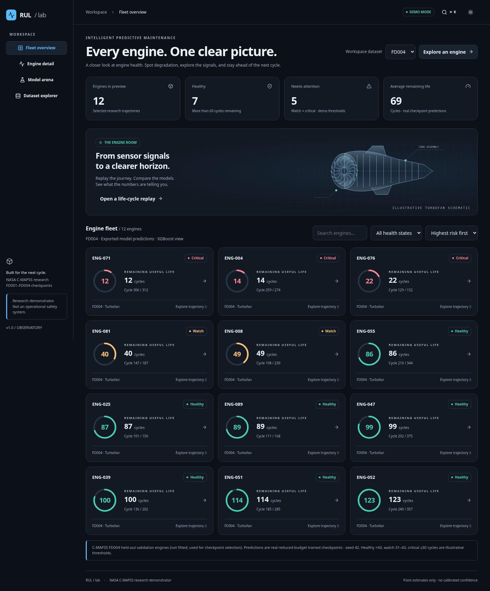

# Intelligent Predictive Maintenance System

A leakage-safe Remaining Useful Life (RUL) pipeline for NASA C-MAPSS.
Published full research comparisons cover FD001 and FD004; committed reduced-budget
portfolio checkpoints now cover all four subsets.
It compares XGBoost against LSTM, GRU, and a small Transformer under one
engine-level experimental protocol, with the official test set held out until
final evaluation.

## Interactive product UI

The new **RUL Observatory** lives in [frontend/](frontend/README.md): a self-contained Next.js experience with fleet risk ranking, cycle replay, model comparison and dataset exploration. Run `cd frontend && npm ci && npm run dev`. Default demo mode needs no backend. Replay, sensor permutation importance and static what-if outputs now come from 16 real reduced-budget checkpoints across FD001–FD004. Original published three-seed metrics below remain distinct and unchanged.



See [frontend setup and architecture](frontend/README.md), [audit](AUDIT.md), [research](RESEARCH.md), [decisions](DECISIONS.md), and [QA](frontend/QA.md).

## Published FD001 Result

| Model | MAE | RMSE | NASA/PHM08 Score |
| --- | ---: | ---: | ---: |
| XGBoost | 9.263 +/- 0.368 | 12.369 +/- 0.161 | 239.092 +/- 9.234 |
| Transformer | 9.886 +/- 0.210 | 13.574 +/- 0.331 | 338.386 +/- 25.927 |
| LSTM | 10.019 +/- 0.174 | 13.805 +/- 0.294 | 356.955 +/- 38.283 |
| GRU | 10.038 +/- 0.410 | 13.856 +/- 0.465 | 340.976 +/- 47.797 |

These are the actual results from three seeds (`42`, `1337`, and `2026`), not
tuned showcase values. XGBoost was best on every reported aggregate metric.
See [the FD001 experiment card](docs/EXPERIMENT_CARD_FD001.md) for the full
protocol, leakage controls, and limitations.

## Published FD004 Result

| Model | MAE | RMSE | NASA/PHM08 Score |
| --- | ---: | ---: | ---: |
| XGBoost | 11.177 +/- 0.086 | 15.924 +/- 0.150 | 1442.499 +/- 166.958 |
| Transformer | 11.382 +/- 0.822 | 16.387 +/- 1.596 | 1706.756 +/- 679.180 |
| GRU | 10.787 +/- 0.518 | 16.447 +/- 1.009 | 1909.921 +/- 580.499 |
| LSTM | 11.331 +/- 0.936 | 17.963 +/- 2.509 | 4575.788 +/- 4984.534 |

These are the actual results from the fixed three-seed protocol. XGBoost has
the strongest aggregate RMSE and NASA Score; GRU has the lowest aggregate MAE.
The large LSTM NASA-Score variance is retained because one seed made several
severe RUL underestimates. See [the FD004 experiment card](docs/EXPERIMENT_CARD_FD004.md).

## Why This Is Trustworthy

- C-MAPSS files are validated against their 26-column schema.
- RUL labels are capped at 125 cycles.
- Train/validation partitions are split by engine, before preprocessing or
  window construction.
- Feature selection, scaling, and optional operating-regime handling fit only
  on training engines and persist with the run artifact.
- Windows are constructed per engine, never across engine boundaries.
- XGBoost summary features and neural inputs use the same 30-cycle context.
- The official test set is isolated from fitting, preprocessing, model
  selection, and early stopping.
- Training and serving load the same serialized preprocessor and window code.

## Quick Start

Requires Python 3.11 and [uv](https://docs.astral.sh/uv/).

```bash
make install-all
make data-fd001
make eda-fd001
make data-fd004
make eda-fd004
make test
```

`make data-all` downloads or verifies FD001–FD004 from the same pinned mirror used for FD004, checking frozen SHA-256 and Git blob identities for all twelve files. Individual targets `make data-fd001` through `make data-fd004` are also available. Raw files remain ignored under `data/raw/CMAPSSData/`. See [source and integrity notes](docs/data/README.md); mirror integrity is distinct from NASA authentication. Original provenance is NASA's [C-MAPSS data repository](https://www.nasa.gov/intelligent-systems-division/discovery-and-systems-health/pcoe/pcoe-data-set-repository/).

For the new real-model portfolio workflow, use the [frontend guide](frontend/README.md). It includes committed reduced-budget checkpoints for all four model families and subsets, exact regeneration commands, and the separate evaluation protocol. The full research commands below retain their original settings and published results.

## Reproduce The Comparison

```bash
make experiment-fd001
make experiment-fd004
```

The comparison retrains 12 model/seed combinations, chooses checkpoints using
validation RMSE, and only then evaluates every completed run on the official
test set. It writes per-seed metrics, aggregate comparison tables, plots, and
run directories. The tracked aggregate results are in `results/FD001/`; raw
data, model checkpoints, and per-run artifacts live under ignored paths.

For one XGBoost run:

```bash
make train-xgboost-fd001
.venv/bin/python -m rul_pm.cli evaluate --run-dir runs/FD001/xgboost/latest
```

## Serve A Trained Model

```bash
export RULPM_ARTIFACT_DIR=runs/FD001/xgboost/latest
make serve
```

The FastAPI app loads the persisted preprocessor and model artifact from
`RULPM_ARTIFACT_DIR`. It returns a point prediction and stored historical
metrics; it does not claim per-prediction uncertainty.

## Repository Map

```text
configs/       Fixed FD001 and FD004 experiment configurations
docs/          Experiment cards and methodological boundaries
scripts/       Dataset acquisition helper
src/rul_pm/    Ingestion, preprocessing, windows, models, training, API
tests/         Leakage, boundary, persistence, and API-parity tests
results/       Versioned aggregate FD001 and FD004 experimental results
```

GitHub Actions runs the test suite without downloading the dataset or running
the expensive full experiment.
