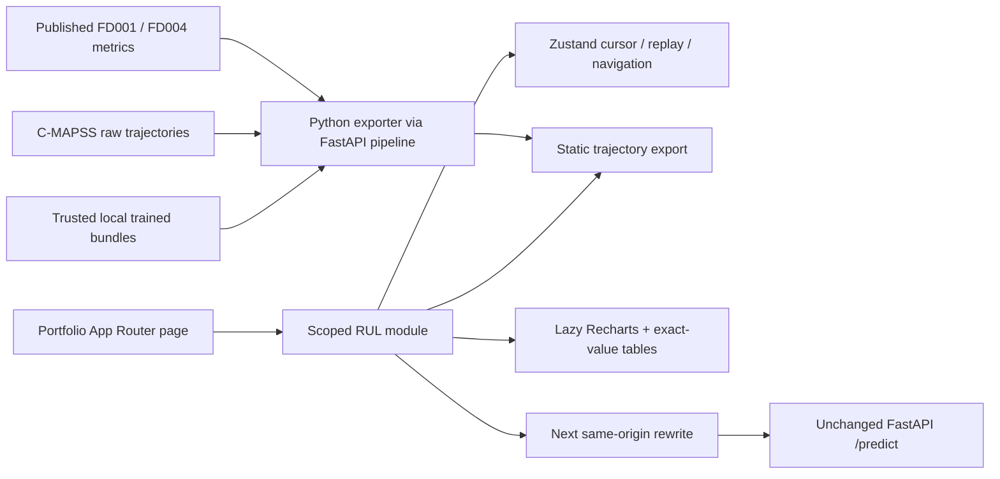

# RUL Observatory

An embeddable Next.js + TypeScript research experience for NASA C-MAPSS. Fleet risk ranking, synchronized cycle scrubber, live replay, model overlays, published benchmarks, residual views, exploratory sensor drift, what-if controls, correlation heatmap, command palette, dark/light themes and reduced-motion support.


[Mobile fleet](qa/fleet-360.png) · [Engine workspace](qa/engine-1440.png) · [Model arena](qa/arena-1440.png) · [Dataset explorer](qa/explorer-1440.png) · [Light theme](qa/light-1440.png)

## Run

Node 22+ recommended (validated with Node 24). No Python/backend is required in the default demo mode.

```bash
cd frontend
npm ci
npm run dev
# Production:
npm run build
npm start
```

The server listens on port 3000. Use `PORT` to change it. Build uses webpack: this environment's Turbopack CSS worker encountered local-socket permission failures. Dependencies are locked in package-lock.json. No remote fonts or image services are needed.

## Evidence and demo mode

`NEXT_PUBLIC_DEMO_MODE` defaults to true. The committed `public/demo.json` contains measured FD004 training sensor trajectories for 12 engines, measured training correlations, and **illustrative mathematical predictions**, not trained-model predictions. It includes actual capped RUL from run-to-failure training lengths. The UI states this distinction. The arena's aggregate FD001/FD004 scores come directly from the repository's published three-seed results. These are independent of replay charts. Dataset FD002/FD003 show honest empty states; FD001 has metrics but no installed trajectories.

The what-if demo is a simple deterministic sensitivity heuristic, not a causal model or inference result. Sensor bars show drift, not SHAP importance. No calibrated confidence is presented. Thresholds of 30/60 cycles are illustrative and must not guide safety decisions.

Regenerate illustrative data from the repository root (existing Python environment):

```bash
.venv/bin/python frontend/scripts/export_demo.py
```

Export real precomputed predictions from explicitly provided trained bundles:

```bash
.venv/bin/python frontend/scripts/export_demo.py --subset FD004 \
  --bundle xgboost=runs/FD004/xgboost/latest \
  --bundle lstm=runs/FD004/lstm/latest \
  --bundle gru=runs/FD004/gru/latest \
  --bundle transformer=runs/FD004/transformer/latest
```

Run `--help` for output location and engine-count options. Only load trusted local bundles: joblib/PyTorch serialization can execute code. The exporter checks model metadata and calls the unchanged FastAPI prediction pipeline for each prefix. It requires XGBoost for fleet risk ranking; other missing model series remain unavailable, never fabricated. Dataset raw files must exist. Production weights are absent here; the trained-export code path was exercised separately with a synthetic test artifact, not a research-trained model. Real exported training trajectories are in-sample visualization, not a held-out evaluation. Do not compare their residuals with published held-out scores.

`NEXT_PUBLIC_RUL_DATA_URL` overrides the static JSON URL (set before build). Schema is in `src/modules/rul/types.ts`. Build-time `NEXT_PUBLIC_DEMO_MODE=false` enables real what-if requests:

```bash
# Repository root, first terminal (provide your trusted trained bundle):
RULPM_ARTIFACT_DIR=runs/FD004/xgboost/latest .venv/bin/python -m uvicorn rul_pm.api.app:create_app --factory --host 127.0.0.1 --port 8000
# frontend/, second terminal:
NEXT_PUBLIC_DEMO_MODE=false API_BASE_URL=http://127.0.0.1:8000 npm run build
npm start
```

The Next rewrite forwards `/api/predict` to `/predict`. The live UI test was verified against a synthetic smoke bundle, including sensor payloads, success, backend error and retry. API_BASE_URL is server configuration, never a browser credential. The configured backend serves one model; the model name returned by the API is displayed. The flag changes what-if inference, not the provenance of static replay data. Model comparison remains from the static export. Do not send credentials in public environment variables. For public hosting, keep backend private behind a controlled server proxy and add request limits/authentication appropriate to your deployment.

## Portfolio embedding

Copy `src/modules/rul/` into your portfolio. Import `Observatory` from that folder in any App Router page, for example `app/projects/rul/page.tsx`. Install the frontend runtime dependencies, configure `@tailwindcss/postcss`, and copy demo.json into your public folder or set NEXT_PUBLIC_RUL_DATA_URL. The module uses relative internal imports. No `@/` alias is required inside it.

All styles and tokens are scoped under the CSS module root, including the Radix dialog portal. Tailwind is referenced for local @apply; there is no preflight, body reset or global stylesheet. The example app layout's body margin is host-level scaffolding and should not be copied into a portfolio. Color/type/spacing/radius/motion tokens live in styles.module.css. Model palette has separate AA-friendly light colors. Data fetch is lazy; charts are dynamically imported. No global keyboard behavior fires while typing or using buttons; Cmd/Ctrl+K opens the focus-trapped palette. Space toggles replay and arrows step cycles on the engine workspace. Playback stops when leaving the view and at end of life.



## QA

```bash
npm run lint
npm run typecheck
npm run build
npm start # keep running in another terminal
npm test
CHROME_PATH=/usr/bin/chromium npx lighthouse http://127.0.0.1:3000 \
  --chrome-flags='--headless --no-sandbox' --only-categories=performance,accessibility
```

The Playwright config uses the installed `/usr/bin/chromium`; override CHROME_PATH when needed. Install Chromium through your normal Playwright setup on other machines. Browser tests exercise real UI states, cursor/playback, model pages, missing data, what-if stale results, theme, dialog focus, retry, console errors and axe scans at 360/768/1440. Results and limits are in [QA.md](QA.md). Screenshots and Lighthouse reports are under qa/.

## Outstanding project work

Research-trained checkpoints, genuine per-engine held-out predictions, model attributions, a live fleet ingestion service, and operational threshold calibration remain absent. FD001–FD003 raw data are absent; FD002/FD003 lack acquisition/config/evaluations. Full retraining was not requested or run. [AUDIT.md](../AUDIT.md), [RESEARCH.md](../RESEARCH.md), and [DECISIONS.md](../DECISIONS.md) contain the evidence and choices. Python model/training code and API response shapes are unchanged. A minimal API ingestion fix converts sensor/settings columns to floats for JSON integer measurements; see DECISIONS.md and the added regression coverage.
