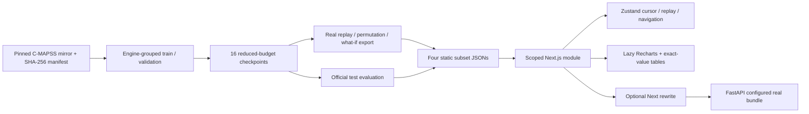

# RUL Observatory

A self-contained Next.js/TypeScript module for NASA C-MAPSS with **real XGBoost, LSTM, GRU and Transformer checkpoints on FD001–FD004**. The default backend-free demo serves precomputed model predictions, permutation importance and exact single-sensor what-if outputs. No synthetic replay prediction fallback remains.


[Mobile](qa/fleet-360.png) · [Engine workspace](qa/engine-1440.png) · [Model arena](qa/arena-1440.png) · [Dataset explorer](qa/explorer-1440.png) · [Light theme](qa/light-1440.png)

## Run

Node 22+ (validated on Node 24):

```bash
cd frontend
npm ci
npm run dev
# Or production:
npm run build
npm start
```

Default port: 3000. No Python or backend is required to use the real static demo. `NEXT_PUBLIC_DEMO_MODE=true` means static delivery, **not illustrative predictions**. The workspace selector loads each subset's actual engine trajectories. `NEXT_PUBLIC_RUL_DATA_URL` optionally overrides the JSON URL; include `{subset}` as a placeholder for multi-subset hosting. A small catalog loads the fleet first; full-resolution histories and exact perturbation outputs load only when entering an analysis view. Charts also load lazily. No remote fonts or image service is required.

## What is real

- All twelve raw train/test/RUL files are verified against SHA-256 and Git blob IDs from the same pinned mirror commit used for FD004. See [source manifest](../docs/data/cmapss-manifest.json) and [integrity notes](../docs/data/README.md). Mirror integrity is not an independent NASA signature.
- Sixteen trusted local checkpoint bundles are committed under `artifacts/portfolio/`, approximately 4 MB total. Their configurations, preprocessing state and checksums are retained. The original model/training implementations were reused unchanged.
- Training uses full engine-grouped 80/20 train/validation splits, seed 42, three neural epochs and 120-tree XGBoost caps. Exact settings are in [DECISIONS.md](../DECISIONS.md) and `configs/portfolio/`. These are reduced-budget demonstrator models, not the original three-seed published research runs. Some neural errors are substantially higher.
- Metrics displayed in the arena belong to these exact checkpoints on the official test engines. They are single-seed results; no variance is claimed. Original published scores under results/FD001 and results/FD004 are preserved and not mixed with these weights. Per-engine test outputs are retained in `results/portfolio/`.
- Replay uses twelve **validation** engines per subset, disjoint from the fitting engines. These engines were used for checkpoint selection, so replay residuals are not independent final test metrics. Actual RUL is known from their run-to-failure trajectories and capped at 125. Padded early windows use the same serving pipeline.
- Importance bars show per-model **permutation increase in MAE (cycles)** across up to 512 validation windows and all 21 sensors, one seeded permutation. The six highest values are displayed; negative scores and dropped sensors are retained in JSON. These are predictive sensitivities, not causal explanations, calibrated uncertainty or SHAP values.
- Static what-if controls use exact model evaluations for one sensor (S2/S4/S11) at a time, at −10/−5/0/+5/+10%, at every exported cycle, for all four models. Changing one slider resets the others. No interpolation, additive surrogate or fabricated result is used. Missing entries produce an error.

**Still illustrative:** the 30/60-cycle health/alert policy and the turbofan schematic are explicitly labeled in the UI. These thresholds are not operational maintenance limits. No physical twin state, causal effect or calibrated confidence is invented.

## Reproduce data, training and exports

From the repository root, using the existing Python environment:

```bash
.venv/bin/python scripts/portfolio/download.py
OMP_NUM_THREADS=2 OPENBLAS_NUM_THREADS=1 MKL_NUM_THREADS=2 \
  MPLCONFIGDIR="$PWD/work/mpl" .venv/bin/python scripts/portfolio/train.py
OMP_NUM_THREADS=2 OPENBLAS_NUM_THREADS=1 \
  .venv/bin/python frontend/scripts/export_demo.py
```

The downloader refuses mismatched existing files. The training runner reuses completed checkpoints only when their saved configuration matches; use a new versioned run directory for a changed protocol. All training/validation selection finishes before official test evaluation begins. It does not overwrite published research results. If bundles are already present, skip training and regenerate directly after verifying/download of raw files.

The exporter writes `public/demo-FD001.json` through `demo-FD004.json` and `demo.json` (default FD004), plus matching `catalog*.json` fleet summaries. Copy both sets for embedding. It batches the original preprocessing/window/model operations, then independently checks baseline and perturbed output against FastAPI for all 16 checkpoints. Observed maximum error is below 0.00002 cycles. `model_bundle.py` is an export adapter, not a new model implementation. `--subset` exports one subset; `--engines` changes preview size (default 12).

Only load trusted checkpoints: joblib and torch serialization can execute code. The committed artifact manifest in `results/portfolio/manifest.json` records SHA-256 for every required bundle file. Static inference does not execute those bundles in the browser.

## Optional live what-if

```bash
# Repository root:
RULPM_ARTIFACT_DIR=artifacts/portfolio/FD004/xgboost/seed_42 \
 .venv/bin/python -m uvicorn rul_pm.api.app:create_app --factory --host 127.0.0.1 --port 8000
# frontend/, another terminal:
NEXT_PUBLIC_DEMO_MODE=false API_BASE_URL=http://127.0.0.1:8000 npm run build
npm start
```

Next rewrites `/api/predict` to the unchanged FastAPI `/predict`. The response identifies the configured backend model. Live mode still serves one configured backend model; the importance selector does not change that server's bundle. Its results may differ from the selected replay model/subset. Use static mode to compare exact per-subset/model what-if outputs without a backend. No API response shape or model/training code changed for this update. The earlier API integer-input normalization remains in place.

## Embed in a portfolio

Copy `src/modules/rul/` into your App Router project and import `Observatory` in a route page. Copy public/demo*.json and public/catalog*.json or configure the data URL template; install this module's runtime dependencies and `@tailwindcss/postcss`. Internal imports are relative; no `@/` alias is required inside the module. Keep the Next rewrite only if enabling live inference.

The CSS module scopes tokens, themes and component styles to its root, including the Radix dialog portal. Tailwind uses local @reference/@apply without a global reset or utility leakage. The example app's body margin is host scaffolding; do not copy that layout into an existing portfolio. Tokens live in styles.module.css. Motion respects reduced-motion preferences; Space toggles replay, arrow keys step cycles, Cmd/Ctrl+K opens the focus-trapped palette. The workspace is one route with in-page Zustand navigation; browser Back does not track its internal views.



## QA and outstanding work

`npm run lint`, `npm run typecheck`, `npm run build`, `npm start`, then `npm test`. Playwright uses `/usr/bin/chromium`; override CHROME_PATH on other machines. For the optional live test, run a second API-enabled UI at port 3001 plus FastAPI, then `LIVE_UI_URL=http://127.0.0.1:3001 npm test` with production static UI on 3000. Without LIVE_UI_URL the live test is explicitly skipped. Python regression command: `.venv/bin/python -m pytest -ra` (limit CPU threads as above).

See [QA.md](QA.md) and qa/ for current results, screenshots and Lighthouse reports. A full-budget multi-seed experiment on FD002/FD003, attribution uncertainty estimates, operational policy calibration, real telemetry ingestion and a physical digital twin remain future research. The current importance is genuine permutation sensitivity, not SHAP or causality. No public deployment was performed.
